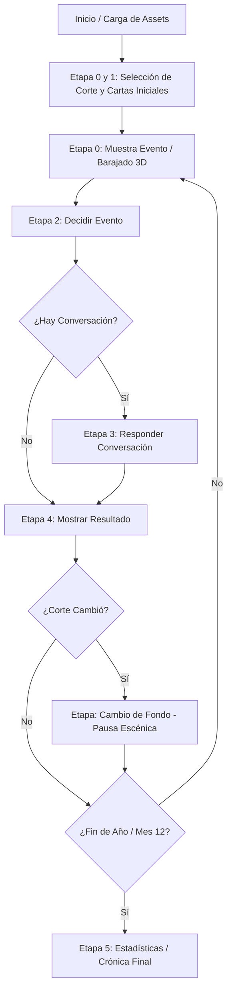

# Auditoría Técnica Integral — Juego Narrativo ("King's Court")

> **Fecha:** 23 de Octubre de 2026  
> **Objetivo:** Radiografía técnica completa de la arquitectura, estilos, animaciones y deudas técnicas del juego narrativo previo a la refactorización y migración a PixiJS para optimización móvil (Play Store / Web) en adultos mayores.

---

## 1. Resumen Ejecutivo y Arquitectura

El **Juego Narrativo** (conocido internamente como `KingsCourt` o la corte medieval) es una experiencia interactiva basada en decisiones secuenciales, gestión de recursos (Ejército, Oro, Pueblo) y progresión por eventos y conversaciones mensuales.

### Stack Tecnológico
* **Framework:** React 19 (`react`, `react-dom`) con Ionic React (`@ionic/react`).
* **Estilos:** Tailwind CSS v4 + 6 archivos CSS tradicionales dedicados con variables dinámicas CSS (`var(--...)`).
* **Gestión de Estado:** Redux Toolkit (`@reduxjs/toolkit`) mediante `narrativoSelectionSlice` y `narrativoCargaSlice`.
* **Animaciones:** Web Animations API (`element.animate`), CSS Keyframes, CSS Transitions, GSAP (`@gsap/react`, `gsap`) y Canvas 2D / PixiJS v8 (en proceso de adopción).
* **Plataforma Objetivo:** Web responsive y aplicativo móvil empaquetado para Google Play Store mediante **Capacitor** (`@capacitor/core`, `@capacitor/android`).

---

## 2. Mapa de Carpetas y Módulos

La totalidad del juego reside en `src/VISTAS/JUEGOS/NARRATIVO/`:

```
src/VISTAS/JUEGOS/NARRATIVO/
├── KingsCourt.tsx                   # Orquestador principal (502 líneas): máquina de estados de etapas
├── KingsCourtCalendar.tsx           # Wrapper de calendario y selección de fecha
├── narrativeService.ts              # Cliente HTTP para endpoints de la partida (/v2/partida/...)
├── narrativeFallback.ts             # Simulación offline / fallback local completo de eventos y cartas
├── narrativeService.test.ts         # Suite de pruebas unitarias
├── narrativo.css                    # Estilos globales y reglas de adaptación para adultos mayores
├── pixiConfig.ts                    # Configuración optimizada de bajo consumo para PixiJS
├── recursos/
│   └── precargaNarrativa.ts         # Precarga de imágenes, catálogos y gestión de caché de assets
├── COMPARTIDOS/
│   ├── BOTON_NARRATIVO/
│   │   └── BotonNarrativo.tsx       # Botones temáticos con variantes (decisión, acción, secundario)
│   ├── CARGA_NARRATIVA/
│   │   ├── CargaNarrativa.tsx       # Pantalla de carga con progreso y botón entrar
│   │   └── cargaNarrativa.css       # Animación del caballo al trote y barra de carga
│   ├── CONFIGURACION_EDAD/
│   │   └── ConfiguracionEdad.tsx    # Modal de ajuste de edad y accesibilidad cognitiva
│   ├── DIALOGO_NARRATIVO/
│   │   └── DialogoNarrativo.tsx     # Caja de texto pergamino, opciones de decisión y avatar
│   ├── FONDO_CORTE/
│   │   ├── FondoCorte.tsx           # Renderizador del fondo y capas de ambientación
│   │   ├── CapaFondoCorte.tsx       # Manejo de capas DOM individuales (guardias, manos, oro)
│   │   └── fondoCorte.css           # Estilos con Container Queries y filtros pesados
│   ├── MAZO_UI/
│   │   └── MazoUi.tsx               # Visualizador de cartas en mano y tags activos
│   ├── PAPEL_UI/
│   │   └── PapelUi.tsx              # Contenedor con estética de pergamino desgastado
│   ├── TITULO_NARRATIVO/
│   │   ├── TituloNarrativo.tsx      # Título ornamental con marco dorado y entrada/salida
│   │   └── TituloConversacion.tsx   # Título contextual para diálogos entre personajes
│   └── TRANSICION_NARRATIVA/
│       └── TransicionNarrativa.tsx  # Componente clase que clona el DOM para transicionar etapas
├── ETAPA_0_1_SELECCIONAR_CARTAS/
│   ├── SeleccionarCartasEtapa0y1.tsx # Selección de cartas iniciales y conformación de la corte
│   ├── CartaSeleccionableEtapa0y1.tsx # Carta interactiva individual con marco y reverso
│   ├── cartas.css                   # Grid de cartas, efectos de brillo y selección
│   └── shuffleCartas.ts             # Utilidad de mezcla de cartas
├── ETAPA_0_MUESTRA_EVENTO/
│   ├── MuestraEventoEtapa0.tsx      # Presentación del evento mensual entrante con barajado
│   ├── cicloEvento.ts               # Lógica de temporización del evento
│   └── muestraEvento.css            # Animaciones 3D de barajado y abanico de cartas
├── ETAPA_2_DECIDIR_EVENTO/
│   └── DecidirEventoEtapa2.tsx      # Escena del evento, condiciones secretas y opciones
├── ETAPA_3_RESPONDER_CONVERSACION/
│   └── ResponderConversacionEtapa3.tsx # Diálogo cara a cara con personajes de la corte
├── ETAPA_4_MOSTRAR_RESULTADO/
│   └── MostrarResultadoEtapa4.tsx   # Consecuencias de la decisión y cambios en el reino
└── ETAPA_5_ESTADISTICAS_PARTIDA/
    ├── EstadisticasPartidaEtapa5.tsx # Pantalla final, crónica de los 12 meses y balance
    ├── estadisticasModel.ts         # Agrupación y cálculo de datos de la crónica
    └── estadisticas.css             # Estilos de la crónica con border-image y gráficos SVG
```

---

## 3. Inventario Detallado de Archivos CSS

El juego narrativo cuenta con **6 archivos CSS**. Cada uno tiene propósitos específicos y particularidades técnicas:

### 3.1. `narrativo.css` (7.096 bytes — 138 líneas)
* **Propósito:** Ajustes estructurales de la escena, variables dinámicas para adultos mayores y orquestación de la visibilidad de los diálogos.
* **Selectores clave:**
  * `.narrativo-modo-mayor`: Modifica tamaños de fuente (`var(--narrativo-texto-adaptado)`), alturas mínimas de botones (`64px`), tamaños de retratos y suprime animaciones innecesarias (`animation: none`).
  * `.titulo-narrativo[data-intro='listo'] .titulo-narrativo__arte`: Animación de entrada y salida del título de 3800ms (`narrativo-presentar-titulo`).
  * `.conversacion-escena`, `.conversacion-retrato`: Transiciones de retratos (`opacity 700ms`, `transform 700ms`).
  * Media queries para móvil (`@media (max-width: 767px)`): Ajustes con `100dvh`, `safe-area-inset-top` y `safe-area-inset-bottom`.
* **Problemas detectados:** Uso de `-webkit-backdrop-filter: blur(4px)` y `radial-gradient` en pseudoelementos superpuestos con máscaras CSS (`mask-image`), lo cual fuerza rasterizaciones lentas en GPU móvil.

### 3.2. `COMPARTIDOS/FONDO_CORTE/fondoCorte.css` (3.454 bytes — 69 líneas)
* **Propósito:** Proyección del fondo de la sala del trono (`court.jpg`) y posicionamiento de guardias, manos del pueblo y cofres de oro.
* **Selectores clave:**
  * `.fondo-corte`: Define `container-type: size;` y `.fondo-corte__plano` usa `max(100cqw, 177.777778cqh)`.
  * `.fondo-corte__elemento`: Posicionamiento absoluto vía variables `--x`, `--y`, `--apoyo`, `--tamano`.
  * `@media (orientation: portrait)`: Sobrescribe posiciones de guardias a `top: 87%`, oro a `top: 98%`, manos a `min(8cqh, 40px)`.
* **Problemas detectados (Causa principal del sobrecalentamiento):**
  1. **Doble cálculo:** Mezcla Container Queries (`cqw/cqh`) con Media Queries globales (`orientation: portrait`).
  2. **Filtros pesados por software:**
     * Manos: `filter: brightness(.42) saturate(.35) contrast(1.2) sepia(.12) blur(.55px) drop-shadow(0 3px 8px #000e); mix-blend-mode: multiply;`
     * Personajes: `filter: sepia(.18) saturate(.65) brightness(.52) contrast(.96) drop-shadow(0 5px 8px #000b);`
     * Oro: `filter: blur(8px)` en pseudoelemento de sombra.
     * Siluetas con máscara en tiempo real: `mask: var(--silueta) center / 100% 100% no-repeat; background: linear-gradient(...)`.

### 3.3. `ETAPA_0_1_SELECCIONAR_CARTAS/cartas.css` (7.029 bytes — 242 líneas)
* **Propósito:** Diseño de las cartas, cuadrícula responsiva, selección y brillos ornamentales.
* **Selectores clave:**
  * `.carta-narrativa`: Aspect ratio `2 / 3`, `drop-shadow(0 6px 8px #0008)`, transición de `translate 180ms`.
  * `.carta-narrativa[data-selected='true']`: Elevación (`translate: 0 -6px`) y resplandor dorado con doble sombra: `filter: drop-shadow(0 0 5px #f3d78a) drop-shadow(0 6px 8px #0008)`.
  * `.carta-narrativa[data-personaje='true'][data-selected='true']::before`: Destello estelar con radial-gradient y `mix-blend-mode: screen`.
* **Evaluación:** Bien resuelto y altamente accesible. Sus efectos deben conservarse intactos.

### 3.4. `ETAPA_0_MUESTRA_EVENTO/muestraEvento.css` (5.201 bytes — 172 líneas)
* **Propósito:** Animación de barajado en perspectiva 3D previa a la revelación del evento mensual.
* **Selectores clave:**
  * `.muestra-evento__mazo`: `perspective: 900px`.
  * `.muestra-evento__carta`: Animación `@keyframes muestra-evento-barajar` con `cubic-bezier(.22, 1, .36, 1)`.
  * `.muestra-evento__seleccionada`: Rotación de 180° en el eje Y (`rotateY(180deg)`) para revelar la cara del evento.

### 3.5. `COMPARTIDOS/CARGA_NARRATIVA/cargaNarrativa.css` (924 bytes — 19 líneas)
* **Propósito:** Loader inicial con caballo galopando.
* **Selectores clave:**
  * `.carga-narrativa__caballo--trotando`: `animation: caballo-trote 560ms ease-in-out infinite`.
  * `filter: brightness(0) invert(1) sepia(1) saturate(1.8) drop-shadow(0 4px 5px #0008)`.
* **Problemas detectados:** Animación infinita con filtros encadenados mientras la pantalla de carga está visible.

### 3.6. `ETAPA_5_ESTADISTICAS_PARTIDA/estadisticas.css` (1.497 bytes — 30 líneas)
* **Propósito:** Crónica final desplegable con aspecto de pergamino continuo y gráficos de barras / líneas.
* **Selectores clave:**
  * `.cronica-hoja`: `border-image: url('/assets/narrative/result-paper.png') 120 95 fill / 30px 27px`.
  * `.cronica-trazo`: Animación de trazado SVG con `stroke-dashoffset`.
  * `.cronica-barra`: Animación de barras con `transform: scaleY(...)`.

---

## 4. Control de Animaciones: Mecanismos y Cuellos de Botella

El juego implementa **tres capas de animación distintas**, las cuales compiten entre sí por los recursos de la CPU/GPU:

| Mecanismo | Dónde se utiliza | Cómo funciona | Impacto en Rendimiento Móvil |
| :--- | :--- | :--- | :--- |
| **CSS Keyframes y Delays** | Títulos, diálogos, barajado de cartas | `animation-delay` escalonados (desde 800ms hasta 1900ms) para que el fondo entre primero y luego el texto. | Moderado, pero si se interrumpen por un toque rápido pueden dejar elementos invisibles o a medio animar. |
| **DOM Cloning en Transición de Etapas** | `TransicionNarrativa.tsx` | Al cambiar de etapa, ejecuta `actual.cloneNode(true)`, recorre **todos los nodos hijos** con `getComputedStyle(elemento)` para copiar sus estilos, y anima la salida con `actual.animate()`. | **Crítico (Layout Thrashing):** Fuerza un recálculo masivo de estilos en todo el árbol DOM en cada cambio de mes o pantalla. |
| **Transiciones DOM de Fondo** | `CapaFondoCorte.tsx` | Múltiples `requestAnimationFrame` anidados esperando el evento `onLoad` de cada imagen, y `setTimeout(1400)` para desmontar del DOM a guardias que salen. | **Crítico:** Provoca saltos visuales y repinta imágenes de 1920×1080 con filtros pesados al mismo tiempo que entra el diálogo. |

---

## 5. Máquina de Estados y Flujo de Etapas

El flujo se orquesta en `KingsCourt.tsx` mediante la variable calculada `etapa`:



### Características destacables del flujo:
* **Modo Mayor / Adaptación por Edad:** `configuracionPorEdad(edad)` ajusta dinámicamente si las decisiones muestran u ocultan cálculos numéricos complejos (`+10 Ejército`, `-5 Oro`), si el tamaño de texto es de 18px o 24px, y si los controles tienen alturas mínimas aptas para motricidad fina (64px).
* **Precarga de Ilustraciones:** `precargaNarrativa.ts` consulta la API de catálogos y almacena en caché local las imágenes de los eventos siguientes para evitar demoras de red en mitad de la partida.

---

## 6. Deudas Técnicas Identificadas

A continuación se listan las deudas técnicas organizadas por severidad:

### 🔴 Severidad Alta (Rendimiento, Batería y Estabilidad Móvil)
1. **D1. Doble cálculo de geometrías en el fondo (`fondoCorte.css`):**
   * Coexistencia de Container Queries (`container-type: size;` con `max(100cqw, 177cqh)`) y Media Queries (`orientation: portrait`).
   * El navegador recalcula en dos pasadas las posiciones absolutas en cada cambio de orientación o redimensión.
2. **D2. Clonación forzada y Style Thrashing en `TransicionNarrativa.tsx`:**
   * La técnica de `cloneNode(true)` + `getComputedStyle()` iterando todos los nodos del árbol DOM congela el hilo principal (Main Thread) en teléfonos de gama baja al cambiar de pantalla.
3. **D3. Filtros CSS encadenados por software en tiempo real:**
   * Las capas de guardias, manos, oro y caballo de carga utilizan `drop-shadow`, `blur`, `saturate`, `sepia` y `mask-image` sobre el DOM. En GPUs móviles sin aceleración de filtros, esto corre por software (CPU).
4. **D4. Consumo en segundo plano / falta de control de ciclo de vida:**
   * No existe escucha activa de `document.visibilitychange` en las animaciones continuas. Si el usuario minimiza la aplicación, los timers y keyframes pueden seguir corriendo en memoria.

### 🟡 Severidad Media (Arquitectura y Código)
5. **D5. Duplicidad de estado entre React local y Redux:**
   * En `KingsCourt.tsx`, estados como `juego.fondoBase`, `decisionConversacion`, `conversacionPendiente` y `setup` coexisten tanto en `useState` locales como en el store de Redux (`narrativoSelection`), requiriendo sincronizaciones manuales con `useEffect`.
6. **D6. Monolito en `KingsCourt.tsx` (502 líneas):**
   * Concentra la lógica de red, gestión de teclado/back button de Android, timeouts de transición de fondo, adaptación por edad y renderizado condicional de todas las etapas.
7. **D7. Dependencia de valores mágicos en CSS y TS:**
   * Coordenadas porcentuales dispersas entre `fondoCorte.ts`, `fondoCorte.css` y `KingsCourt.tsx` (`top: 87%`, `x: 44.7%`, `y: 55.8%`, `apoyo: 93%`), lo que vuelve frágil cualquier ajuste visual sin romper otra vista.

### 🟢 Severidad Baja (Mantenibilidad)
8. **D8. Tipado laxo (`any`) en etapas narrativas:**
   * Uso frecuente de `any` en firmas de funciones clave de `KingsCourt.tsx` (`prepararCarta = (carta: any)`, `setup: any`, `decision: any`).

---

## 7. Próximos Pasos Sugeridos

A partir de esta auditoría, los cambios a planificar en el archivo `PLAN_CAMBIOS_JUEGO_NARRATIVO.md` se estructuran en:

1. **Paso 1:** Reemplazo controlado del subsistema `FONDO_CORTE` por un canvas PixiJS v8 utilizando `pixiConfig.ts` (render on-demand, fade suave de guardias, un único cálculo de pantalla, 0% CPU en reposo).
2. **Paso 2:** Optimización de `TransicionNarrativa.tsx` para eliminar la clonación con `getComputedStyle` y pasar a transiciones CSS puras o GSAP sin layout thrashing.
3. **Paso 3:** Depuración de filtros CSS innecesarios en elementos estáticos (pre-renderizar sombras o integrarlas en Pixi).
4. **Paso 4:** Limpieza y tipado estricto del orquestador `KingsCourt.tsx`.
