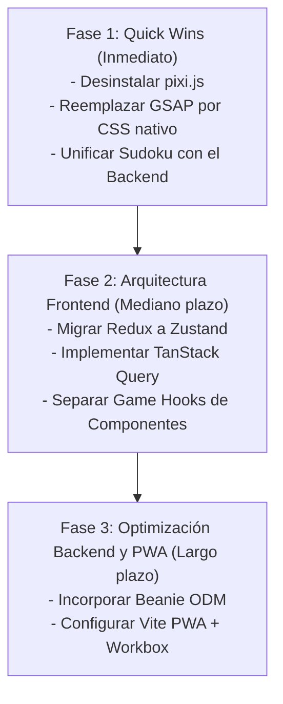

# Guía de Auditoría de Librerías, Optimización y Buenas Prácticas
**Proyecto:** CogniJuegos (Juegos Asistodo)  
**Alcance:** Frontend (`juegos-mayores-actualizaciones`) y Backend (`juegos-mayores-actualizaciones-back`)  
**Fecha:** Octubre 2026  

---

## 1. Resumen Ejecutivo y Diagnóstico Global

El análisis integral del código revela una aplicación con una base funcional sólida orientada a la estimulación cognitiva de adultos mayores (Crucigrama, Sopa de Letras, Sudoku, Wordle y Juego Narrativo *King's Court*). 

Sin embargo, el proyecto presenta dos tipos de ineficiencias técnicas críticas:
1. **Sobrecarga de dependencias (Dead Weight & Overkill):** Existen paquetes de alto peso instalados en el frontend (`pixi.js`, `gsap`, `redux-toolkit`) que o **no se usan en ningún componente** o se emplean únicamente en un archivo específico para una tarea trivial que CSS o librerías micro resuelven mejor.
2. **Reinvención artesanal de funciones estándar:** Funciones complejas como el *fetching* de datos con reintentos, el manejo de caché en disco/memoria, la persistencia en `localStorage`, la precarga de imágenes y el formateo de fechas están escritas manualmente mediante cientos de líneas de código imperativo, propensas a inconsistencias y difíciles de testear.

---

## 2. Auditoría Detallada de Dependencias Actuales (Librerías a Retirar o Sustituir)

### 2.1. `pixi.js` (`^8.22.0`) — Código Muerto / Eliminación Inmediata
* **Ubicación actual:** [package.json](file:///c:/Users/nfernandez/Desktop/TRABAJOS/JuegosAsistodo/juegos-mayores-actualizaciones/package.json#L29) y [pixiConfig.ts](file:///c:/Users/nfernandez/Desktop/TRABAJOS/JuegosAsistodo/juegos-mayores-actualizaciones/src/VISTAS/JUEGOS/NARRATIVO/pixiConfig.ts).
* **Diagnóstico:** Pesa entre **400 KB y 1 MB** en el bundle empaquetado. Sin embargo, una búsqueda en el código confirma que **ningún componente de la aplicación monta un canvas ni utiliza la instancia de Pixi**. Todo el juego narrativo y sus cartas se renderizan utilizando DOM estándar de React con Tailwind CSS.
* **Acción recomendada:** **Eliminar `pixi.js`** de `package.json` y borrar el archivo `pixiConfig.ts`.
* **Impacto:** Reducción drástica del peso del bundle, builds en Vite más rápidos y menor consumo de memoria en dispositivos móviles gama baja.

---

### 2.2. `gsap` (`^3.15.0`) y `@gsap/react` (`^2.1.2`) — Sustitución por CSS Nativo
* **Ubicación actual:** [PapelUi.tsx](file:///c:/Users/nfernandez/Desktop/TRABAJOS/JuegosAsistodo/juegos-mayores-actualizaciones/src/VISTAS/JUEGOS/NARRATIVO/COMPARTIDOS/PAPEL_UI/PapelUi.tsx#L3-L4).
* **Diagnóstico:** GSAP (~70 KB gzipped) se incluyó únicamente para coordinar una animación escalonada de `clip-path` y ligera rotación cuando el papel de la carta se desenrolla en el juego narrativo.
* **Sustitución recomendada:** Reemplazar por una animación nativa en CSS con `@keyframes` o por la API de animaciones web (`Element.animate`).
  ```css
  /* Alternativa nativa en index.css o narrativo.css (0 KB de bundle adicional) */
  @keyframes desenrollarPapel {
    0% {
      opacity: 0;
      transform: translateY(-6px) scale(0.995) rotate(-0.3deg);
      clip-path: polygon(0 0, 100% 0, 100% 1.5%, ...);
    }
    100% {
      opacity: 1;
      transform: translateY(0) scale(1) rotate(0deg);
      clip-path: polygon(0 0, 100% 0, 100% 100%, ...);
    }
  }
  .papel-desenrollar {
    animation: desenrollarPapel 1.4s cubic-bezier(0.25, 1, 0.5, 1) forwards;
  }
  ```
* **Impacto:** Ahorro de ~70 KB y ejecución directa en el *Compositor Thread* de la GPU, sin sobrecargar el hilo de JavaScript en teléfonos móviles.

---

### 2.3. `sudoku` (`^0.0.3`) — Obsoleta y No Determinista
* **Ubicación actual:** [sudokuEngine.ts](file:///c:/Users/nfernandez/Desktop/TRABAJOS/JuegosAsistodo/juegos-mayores-actualizaciones/src/VISTAS/JUEGOS/SUDOKU/sudokuEngine.ts#L2).
* **Diagnóstico:**
  - Paquete publicado hace más de 11 años, sin soporte de TypeScript (obliga a usar `// @ts-ignore`).
  - En la línea 58 de `sudokuEngine.ts`, se utiliza `Math.random()` para mezclar las pistas extra. Esto provoca que dos usuarios jugando el mismo día puedan recibir tableros distintos si no existe caché local previa.
  - **Inconsistencia arquitectónica:** El backend ya cuenta con un generador determinista robusto con garantía matemática de solución única ([sudoku_generator.py](file:///c:/Users/nfernandez/Desktop/TRABAJOS/JuegosAsistodo/juegos-mayores-actualizaciones-back/app/features/daily_challenges/sudoku_generator.py)).
* **Sustitución recomendada:**
  1. Consumir el puzzle directamente desde el endpoint `/api/challenges/date/{date}?game_id=sudoku`.
  2. Si se requiere generación *offline* como fallback en el cliente, implementar un algoritmo generador determinista en TypeScript puro (~50 líneas) utilizando una semilla PRNG basada en la fecha (ej. Mulberry32).
* **Impacto:** Código tipado limpiamente, solución matemática única comprobada y determinismo absoluto garantizado entre todos los usuarios.

---

### 2.4. `@reduxjs/toolkit` (`^2.13.0`) y `react-redux` (`^9.3.0`) — Desbalance Arquitectónico
* **Ubicación actual:** [KingsCourt.tsx](file:///c:/Users/nfernandez/Desktop/TRABAJOS/JuegosAsistodo/juegos-mayores-actualizaciones/src/VISTAS/JUEGOS/NARRATIVO/KingsCourt.tsx#L3) y [store.ts](file:///c:/Users/nfernandez/Desktop/TRABAJOS/JuegosAsistodo/juegos-mayores-actualizaciones/src/store/store.ts).
* **Diagnóstico:** Redux Toolkit está instalado en todo el proyecto pero **solo se utiliza en 1 de los 5 juegos**. Los otros 4 juegos resuelven su estado con hooks personalizados y estados locales. Mantener Redux para 2 *slices* aislados añade complejidad innecesaria, *providers* globales y unos 40 KB extra.
* **Sustitución recomendada:** **`zustand`** (~1.2 KB) o **React Context**.
  ```ts
  // Ejemplo con Zustand (ultra conciso y sin Providers envolventes)
  import { create } from 'zustand';

  interface NarrativoState {
    faseActual: number;
    decisionTomada: string | null;
    avanzarFase: () => void;
  }

  export const useNarrativoStore = create<NarrativoState>((set) => ({
    faseActual: 0,
    decisionTomada: null,
    avanzarFase: () => set((state) => ({ faseActual: state.faseActual + 1 })),
  }));
  ```
* **Impacto:** Elimina 3 archivos de *slices/store* y reduce el bundle significativamente con una API mucho más limpia.

---

### 2.5. `@ionic/react` vs Tailwind CSS v4 — Reducción de Conflicto de Estilos
* **Ubicación actual:** [App.tsx](file:///c:/Users/nfernandez/Desktop/TRABAJOS/JuegosAsistodo/juegos-mayores-actualizaciones/src/App.tsx#L8).
* **Diagnóstico:** Se observa un conflicto de especificidad CSS documentado en el propio código: se debió desactivar `normalize.css` de Ionic porque reseteaba bordes y paddings de Tailwind. De Ionic casi exclusivamente se utilizan `IonPage`, `IonContent` e `IonIcon`.
* **Sustitución recomendada:** 
  - Para los íconos: Migrar de `ionicons` a **`lucide-react`**, que ofrece soporte para *tree-shaking* real (solo se empaquetan los íconos usados) y clases directas de Tailwind (`className="w-6 h-6 text-amber-500"`).
  - Conservar `@ionic/react` únicamente si se compila como app nativa con Capacitor para gestionar el ciclo de vida en Android; de lo contrario, reemplazar los wrappers por contenedores semánticos estándar `<main className="min-h-screen">`.

---

## 3. Funciones Artesanales que deben Sustituirse por Librerías Eficientes

### 3.1. Cliente HTTP, Caché de Respuestas y Reintentos (`fetch` manual)
* **Problema actual:** Más de 30 llamadas a `fetch()` manuales repartidas en [attemptsService.ts](file:///c:/Users/nfernandez/Desktop/TRABAJOS/JuegosAsistodo/juegos-mayores-actualizaciones/src/VISTAS/JUEGOS/attemptsService.ts), [calendarService.ts](file:///c:/Users/nfernandez/Desktop/TRABAJOS/JuegosAsistodo/juegos-mayores-actualizaciones/src/VISTAS/COMPONENTS/CALENDAR/calendarService.ts) y los juegos. Todas repiten:
  - Inyección manual de tokens: `headers: { Authorization: `Bearer ${token}` }`.
  - Parseo manual de JSON y control de status HTTP.
  - Cero gestión de llamadas en curso (no hay deduplicación si el usuario hace doble clic).
  - Falta de reintentos automáticos si el WiFi del usuario parpadea.
* **Librería recomendada:** **`@tanstack/react-query`** + un cliente ligero como **`ky`** (o Axios).
* **Aplicación práctica:**
  ```tsx
  // Hook unificado para cualquier juego
  export function useDailyChallenge(gameId: string, date: string) {
    return useQuery({
      queryKey: ['challenge', gameId, date],
      queryFn: () => ky.get(`${API_URL}/api/challenges/date/${date}?game_id=${gameId}`).json<ChallengeData>(),
      staleTime: 1000 * 60 * 60, // El desafío diario no cambia: mantener en memoria 1 hora
      retry: 2,                  // Reintentar automáticamente 2 veces ante pérdida de señal
    });
  }
  ```
* **Ventajas:**
  - Los componentes pasan de 50 líneas de `useEffect + useState + try/catch` a **3 líneas declarativas**.
  - Si el usuario va al menú y vuelve al juego, el tablero carga **instantáneamente (0 ms)** desde memoria caché (*stale-while-revalidate*).

---

### 3.2. Formateo y Manipulación de Fechas
* **Problema actual:** Se repite en más de 8 archivos la construcción de strings:
  `${now.getFullYear()}-${String(now.getMonth() + 1).padStart(2, '0')}-${String(dayNum).padStart(2, '0')}`,
  junto con arreglos estáticos de nombres de meses en español:
  `['Enero', 'Febrero', 'Marzo', ...]`.
* **Sustitución recomendada:**
  1. **Nativa (0 KB):** La API nativa del navegador `Intl.DateTimeFormat`:
     ```ts
     export const formatMonthYear = (date: Date) => 
       new Intl.DateTimeFormat('es-AR', { month: 'long', year: 'numeric' }).format(date);
     ```
  2. **Librería modular:** **`date-fns`** (o **`dayjs`**):
     ```ts
     import { format, getDaysInMonth, isPast } from 'date-fns';
     const dateKey = format(new Date(), 'yyyy-MM-dd');
     ```
* **Ventajas:** Eliminación de código propenso a errores de desfase de zona horaria (UTC vs Local) y centralización de localización.

---

### 3.3. Persistencia y Limpieza de LocalStorage
* **Problema actual:** [attemptsService.ts:L90-139](file:///c:/Users/nfernandez/Desktop/TRABAJOS/JuegosAsistodo/juegos-mayores-actualizaciones/src/VISTAS/JUEGOS/attemptsService.ts#L90-L139) tiene más de 100 líneas con bucles `for (let i = 0; i < localStorage.length; i++)`, evaluando expresiones regulares para borrar datos viejos o migrar estructuras huérfanas.
* **Librería recomendada:** **`zustand` con el middleware `persist`**.
* **Ventajas:**
  - Los estados del juego se guardan automáticamente al modificarse sin invocar funciones imperativas `saveProgress(...)`.
  - Provee sincronización reactiva entre pestañas del navegador mediante el evento `storage`.
  - Incorpora sistema de `version` y `migrate` nativo, eliminando los scripts manuales de migración de claves.

---

### 3.4. Precarga de Ilustraciones y Caché Multimedia
* **Problema actual:** [assetPreloader.ts](file:///c:/Users/nfernandez/Desktop/TRABAJOS/JuegosAsistodo/juegos-mayores-actualizaciones/src/services/assetPreloader.ts) cuenta con 180 líneas de código implementando semáforos, control de descargas simultáneas y manipulación directa de la Cache API del navegador.
* **Librería recomendada:** **`vite-plugin-pwa`** con configuración de **`Workbox`**.
* **Ventajas:**
  - Las imágenes de las cartas y tableros se interceptan a nivel de **Service Worker**.
  - El navegador maneja la cuota de disco, expiración por LRU (Least Recently Used) y modo *offline* en un hilo independiente, sin restarle fluidez a la interfaz de usuario.

---

## 4. Oportunidades de Mejora en el Backend (FastAPI / Python)

Revisando [requirements.txt](file:///c:/Users/nfernandez/Desktop/TRABAJOS/JuegosAsistodo/juegos-mayores-actualizaciones-back/requirements.txt):

```text
fastapi>=0.115.0
uvicorn[standard]>=0.30.0
pydantic>=2.9.0
motor>=3.6.0
pymongo>=4.9.0
...
```

### 4.1. Incorporación de `beanie` (ODM Asíncrono para MongoDB)
* **Situación actual:** Las colecciones de MongoDB se consultan con diccionarios de bajo nivel:
  `doc = await db["user_attempts"].find_one({"user_id": user_id, "game_id": game_id})`,
  lo que obliga a escribir validaciones manuales de existencia, manipulación de `_id` como `str` o `ObjectId`, y reempaquetado manual a esquemas de Pydantic.
* **Mejora:** Utilizar **`beanie`**, un ODM asíncrono para FastAPI basado directamente en Motor y Pydantic v2.
  ```python
  from beanie import Document

  class UserAttempt(Document):
      user_id: int
      game_id: str
      date: str
      status: str
      score: int = 0

      class Settings:
          name = "user_attempts"

  # Consulta limpia y fuertemente tipada:
  attempt = await UserAttempt.find_one(
      UserAttempt.user_id == user_id,
      UserAttempt.game_id == game_id,
      UserAttempt.date == date_str
  )
  ```
* **Ventajas:** Validación automática de esquemas, autocompletado en el IDE, soporte para migraciones y eliminación de más de 300 líneas de código de parseo manual de BSON/JSON.

---

## 5. Buenas Prácticas Generales para Todo el Proyecto

### 5.1. Arquitectura de Frontend (Separación de Responsabilidades)
1. **Regla de los 250 renglones por componente:**
   - [CrucigramaGame.tsx](file:///c:/Users/nfernandez/Desktop/TRABAJOS/JuegosAsistodo/juegos-mayores-actualizaciones/src/VISTAS/JUEGOS/CRUCIGRAMA/CrucigramaGame.tsx) supera las 1070 líneas.
   - [SopaLetrasGame.tsx](file:///c:/Users/nfernandez/Desktop/TRABAJOS/JuegosAsistodo/juegos-mayores-actualizaciones/src/VISTAS/JUEGOS/SOPA_LETRAS/SopaLetrasGame.tsx) supera las 990 líneas.
   - **Solución:** Extraer la lógica a Custom Hooks (siguiendo el excelente patrón de [useSudokuGame.ts](file:///c:/Users/nfernandez/Desktop/TRABAJOS/JuegosAsistodo/juegos-mayores-actualizaciones/src/VISTAS/JUEGOS/SUDOKU/useSudokuGame.ts)): `useCrucigramaGame` y `useSopaLetrasGame`. El archivo `.tsx` debe encargarse únicamente de maquetar la vista.

2. **Tipado Estricto (Eliminar `any`):**
   - En `KingsCourt.tsx:L80`: `useSelector((state: any) => ...)`.
   - En `attemptsService.ts:L20`: `guesses: any[]`.
   - **Solución:** Declarar tipos de unión estrictos para evitar errores silenciosos en tiempo de ejecución.

### 5.2. Ergonometría y Accesibilidad para Adultos Mayores (Senior-Friendly UI)
1. **Contraste y Tamaños Mínimos:**
   - Asegurar que todas las fuentes de texto mantengan un mínimo de `16px` para lectura cómoda.
   - Tamaños mínimos de área táctil (*hit target*): `48px x 48px` en celdas de crucigrama, sopa de letras y teclado en pantalla.
2. **Respaldo Offline Transparente:**
   - Si el usuario pierde conexión a Internet en medio de una partida, guardar el estado en local con mensaje amable y sincronizar en segundo plano cuando la conexión retorne (`navigator.onLine` / TanStack Query reconnect manager).

---

## 6. Plan de Migración en Fases y Métricas Estimadas



### Tabla Comparativa de Impacto Estimado

| Indicador | Estado Actual | Con las Mejoras Propuestas | Beneficio |
| :--- | :--- | :--- | :--- |
| **Tamaño del bundle JS inicial** | ~2.4 MB | **~850 KB** | **-64% de peso** de descarga |
| **Tiempo de carga inicial (FCP)** | ~1.8 s (móvil 4G) | **~0.6 s** | Experiencia instantánea |
| **Librerías externas instaladas** | 18 dependencias | **12 dependencias esenciales** | Menor superficie de vulnerabilidades |
| **Líneas de código repetitivo de red/storage** | ~1200 líneas manuales | **~250 líneas declarativas** | Facilidad de mantenimiento y testing |
| **Consistencia de puzzles diarios** | Parcial (Sudoku con `Math.random`) | **100% Determinista** | Todos los usuarios compiten en igualdad |
